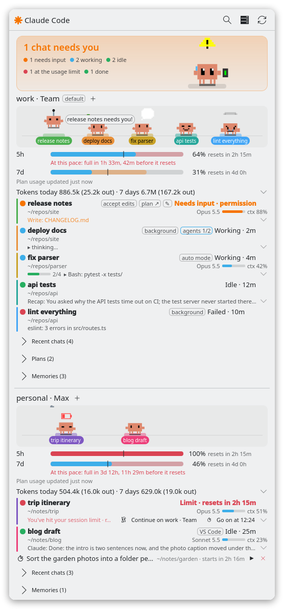
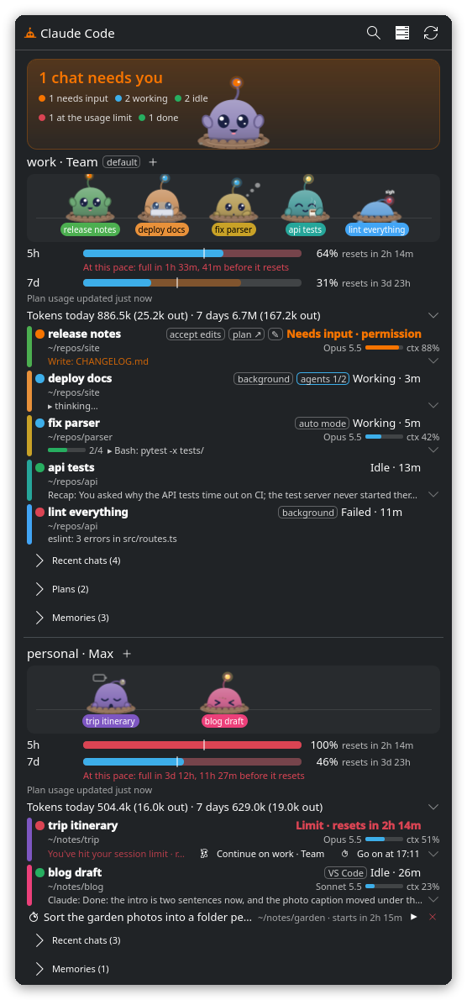
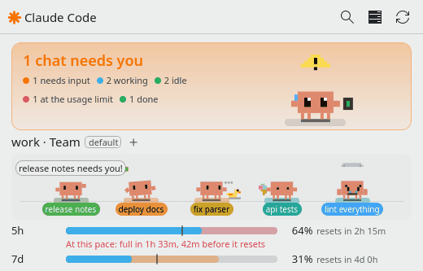
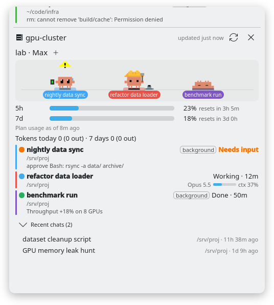

<div align="center">

# Claude Status

**A KDE Plasma 6 widget that keeps all your Claude Code sessions in view.**

Which chats are working, which need you and how much of your plan is left,
across all your accounts and SSH hosts, one click away on your panel.

[](https://github.com/wzaielamri/claude-status-plasmoid/actions/workflows/tests.yml)
[](https://kde.org/plasma-desktop/)
[](https://www.python.org/)
[](LICENSE)

&nbsp;

</div>

> [!NOTE]
> An independent project: not affiliated with or endorsed by Anthropic, and written with AI assistance. See [About this project](#about-this-project).

## Features

**See everything at a glance**

- **Panel icon:** a ✳ spark in the state color: orange with a red badge counting the sessions that need you, blue and spinning while Claude works, green when it's your turn, grey when nothing runs. The 5-hour usage of the account you're using sits next to it.
- **The big Clawd** at the top of the popup sums it all up. His stage glows orange (gently pulsing) when a chat needs you, blue while chats work, green when it's your turn, and turns into a starry night once everything is done. His headline says what matters most, e.g. *2 chats need you*: click it to go there.
- **One section per Claude account** (profiles logged into the same account are merged): plan usage with reset countdowns, tokens for today and the last 7 days, and every session (terminal, background job or VS Code) with its state, how long it's been in it, project folder, model and context fill, plus what a waiting session asks for (e.g. *approve Bash: rm -rf build/*).
- **A pet for every chat:** each account's chats walk on a little stage under its name, wearing the chat's name and color. The chat's row in the list gets a bar in the same color. A pet acts its chat out: it works (types, tests, reviews, juggles subagents), holds up a warning sign when the chat needs you, relaxes when it's your turn, sleeps once the chat is done and looks sad if it failed. Click a pet to open its chat.

<p align="center"></p>

**Act on your sessions**

- **Jump to a session** by clicking its name: Konsole switches to the right tab (or tmux to its pane), VS Code opens the conversation, and a background job is attached in a terminal. Finished chats reopen with `claude --resume`.
- **Start a new chat** with the **+** next to an account: pick one of its recent project folders, and a terminal opens with Claude in it.
- **Stop** a background session (■; it asks first and keeps the conversation) or **hide** a finished one (－; nothing is deleted).
- **Recent chats** per account, to reopen older conversations.
- **Notifications** when a session needs you or finishes a long turn, with sounds from your sound theme (quiet during Do Not Disturb). Click one to jump to the session.

**Beyond this computer**

- **SSH hosts:** pick hosts from your `~/.ssh/config`, and their Claude accounts, sessions, usage and recent chats join the dashboard. Nothing is installed on the host.
- **Several profiles and accounts:** every `~/.claude` and `~/.claude-*` config folder is found automatically, including linked ones such as `~/.claude` → `~/.claude-work`.
- **Shared chats:** a chat shared between profiles is listed once, where it runs, with a pointer from the other accounts.

<p align="center"></p>

<details>
<summary><b>All the details</b></summary>

- **SSH hosts:** the server button at the top lists the hosts in your `~/.ssh/config` (with `Include`s). Tick one and its Claude accounts show up below your own, like a second machine on the same dashboard:
  - its sessions count in the panel icon and at the top of the popup, and send the same "needs input" / "finished" notifications (with the host's name)
  - click a session or recent chat to bring it up. A background session or finished chat opens in a local terminal running `ssh -t <host> claude attach …` / `claude --resume …` in the right folder. A chat running in **VS Code connected to the host (Remote-SSH)** shows in that VS Code window (the one titled `[SSH: <host>]`), which opens on the host if it isn't open yet. A chat running in a terminal here (`ssh <host>`, then `claude`) brings up that terminal tab.
  - **+** starts a new chat there; ■ and － stop or hide its background sessions
  - checked every 30 seconds (configurable) while it's ticked; the ✕ next to the host's name hides it again
  - needs key-based login (the widget can't type a password: load your key with `ssh-add`, or log in once in a terminal to accept a new host key) and `python3` on the host. Nothing is installed there: the status script is sent over the connection each time. It keeps its caches in the host's `~/.cache/claude-widget`, like here. One connection per host stays open for a few minutes, so checks through a jump host are quick.
- **Subagents:** a session that started subagents shows an **agents 2/3** tag (finished/total), outlined while any are running. Click it for a tree of its agents, nested agents included: each one's type, task, running/done/stopped, and what it is doing right now (e.g. `Bash: pytest -x`, `Edit: parser.py`, or the first line of its final answer).
- **Shared chats:** a chat shared across profiles (one transcript hard-linked into each profile) gets a **⇄ shared** tag. Its tooltip lists the profiles and, when known, which one has it open. It's listed once, under the account it runs on, or, once it's finished, the account it was used on last. Every other account it's shared with shows a short line pointing there (e.g. *⇄ my chat · on personal · Working*), and clicking it jumps to the chat.
  - When Claude forks a shared chat into a chat of its own (e.g. when a background session takes it over), that copy gets a **⇄ shared copy** tag: its new messages are only on that account. If the shared chat continued in the copy, the copy is listed instead of the chat, and the other accounts point to it (*copy on personal*).
  - A shared chat's tokens appear in every profile it's shared with, since a transcript doesn't record which account paid; the token tooltip shows how much that is.
  - **Share from the widget** (only with the [shared-chat tool](#shared-chat-tool)): hover a finished chat (or a recent one) and press its share button: **Continue on work** (shares it if needed and opens it there with `claude --resume`, the quick way on when one account hits its limit), **Share with all accounts**, or **Keep only on personal…** (asks first). Nothing is done to a chat while a session has it open.
- **Pets:**
  - a chat's pet stays the same pet, with the same color and on the same spot, as long as the chat is in the list, even while it finishes and runs again; a new chat's pet lines up on the right. When the chat leaves the list (you hide it, its terminal closes, or it gets old), the pet waves and walks off. Up to 5 pets per account (configurable); with more chats, the ones that need you get a pet first, and "+N" counts the rest.
  - the big Clawd (93 poses) takes the news that isn't about one chat's pet, such as limit resets. While Claude works he types, thinks, tests, reviews, debugs or talks to his rubber duck; at ≥ 90% of the 5-hour limit he's mind-blown or overheated now and then, and at 100% he shows a **429**. When things are quiet he wanders, takes coffee breaks and has hobbies (reading, music, gaming, gardening, stargazing, …), dresses for the season and greets you on holidays.
  - click Clawd to pet him (click quickly to tickle him), double-click to make him dance, drag to pick him up and drop him (he gets dizzy from high up)
  - notification icons show him with a warning sign (needs input), a trophy (finished) or a rain cloud (failed)
  - they only move while the popup is open
- **Jumping, in detail:** terminal sessions: Konsole switches to the tab running it (or tmux to its pane) and the window comes to the front. VS Code sessions: the conversation opens in the VS Code window of that project. Background jobs: the terminal already showing the job comes to the front; if there is none, a new terminal runs `claude attach <id>` in the job's folder. A finished background job is reopened the same way; if it ran in a folder Claude doesn't trust yet (always so for your home folder), Claude first asks whether you trust it, with "No, exit" preselected, and the terminal says so before the question comes up.
- **Hiding finished sessions** only hides them in the widget; nothing is deleted, and you can still resume the conversation. A hidden session comes back by itself if it runs again, and right-click → *Show removed sessions again* brings all of them back. The widget deliberately has no real "delete": that can't be undone, and Claude's `claude rm` also removes a background session's worktree.
- **Stopping** runs `claude stop <id>`: the conversation is kept and `claude attach <id>` resumes it. A session that is *working* is interrupted mid-step, and anything it started in the background stops too. Terminal sessions have no stop button; close their window instead.
- **Notifications:** when a session needs you (a permission prompt, a question, or a background job that stopped to ask you something; closed again once you answer), and when a session finishes a turn that took at least 30 seconds (configurable, or off). Sounds: one each for "needs input", "finished" and "failed", from your sound theme, a sound file of your own, or none. They go through PipeWire's notification stream, so the system's notification volume applies. When several sessions change at once, only the most urgent sound plays.

</details>

## Requirements

- **KDE Plasma 6** (6.0 or newer). Plasma 5 isn't supported: Kubuntu 24.04 LTS, for example, ships Plasma 5.27.
- **Claude Code** (the `claude` command), signed in.
- **python3**, 3.7 or newer. Every Plasma 6 distribution already has it.
- **jq**, for the status-line snippet that supplies plan usage and context.
- Optional:
  - **Konsole**, so that clicking a session switches to its tab. With other terminals the window is raised. New terminals open in your default terminal (System Settings → Default Applications).
  - **Qt 6.10 or newer with the QtQuick.VectorImage module**, for animated pets. Without it the pets are still images that walk, hop and react all the same.
  - **PipeWire** (`pw-play`) or PulseAudio (`paplay`) for sounds.
  - tmux; VS Code with the Claude Code extension.

| Distribution | Extra packages |
|---|---|
| Fedora KDE | `sudo dnf install jq` (animated pets work out of the box) |
| Kubuntu, KDE neon, Debian | `sudo apt install jq`, and for animated pets on Qt 6.10+ (e.g. Kubuntu 26.04): `sudo apt install qml6-module-qtquick-vectorimage` |
| Arch Linux | `sudo pacman -S jq` |
| openSUSE | `sudo zypper install jq` |

**Tested on:** Fedora 44 (Plasma 6.7, Qt 6.11), in daily use; Kubuntu 26.04 LTS (Plasma 6.6, Qt 6.10) and Kubuntu 25.10 (Plasma 6.4, Qt 6.9): install, uninstall, the popup and the test suite.

## Installation

```bash
git clone https://github.com/wzaielamri/claude-status-plasmoid.git
cd claude-status-plasmoid
./install.sh
```

Then right-click your panel → **Add Widgets…**, search for **Claude Status** and drag it onto the panel (or onto the desktop).

`install.sh` does two things:

1. It installs the widget for your user (into `~/.local/share/plasma/plasmoids/`) with `kpackagetool6`.
2. It adds a small snippet to the status-line script of each Claude profile (the script that `statusLine` in `~/.claude*/settings.json` runs). It shows the change and asks first (`--yes` skips the question), and keeps a backup next to the script. The snippet saves the status-line data (plan limits, context) for the widget. What your status line shows stays the same.

<details>
<summary><b>No status line yet?</b></summary>

Plan usage and context come from Claude Code's status line. If you don't have one yet, this minimal one shows the model and the folder:

```bash
cat > ~/.claude/statusline.sh <<'EOF'
#!/bin/bash
input=$(cat)
jq -r '"\(.model.display_name) · \(.workspace.current_dir | split("/") | last)"' <<<"$input"
EOF
chmod +x ~/.claude/statusline.sh
```

Add this entry to `~/.claude/settings.json` (and likewise for other profiles such as `~/.claude-work`):

```json
"statusLine": { "type": "command", "command": "~/.claude/statusline.sh" }
```

Then run `./install.sh` again to add the snippet.

</details>

<details>
<summary><b>Manual installation</b></summary>

```bash
kpackagetool6 -t Plasma/Applet -i package
```

Then paste `statusline-snippet.sh` into your status-line script, right after the line that reads its input (`input=$(cat)`).

</details>

## Usage

| Where | What it does |
|---|---|
| Panel icon | Left-click opens the popup, middle-click refreshes. Right-click: *Refresh*, *Show removed sessions again*, *Open Usage Page on claude.ai*, and the settings. |
| The big Clawd | Click his headline (*… needs you*) to go to that chat. Click him to pet him, double-click to make him dance, drag him around. |
| A session's name | Jumps to the session: its terminal tab, its VS Code window, or a terminal attached to the background job. |
| Hovering a session | ■ stops a background session, － hides a finished one, and the share button shares a chat (with the shared-chat tool). |
| A chat's pet | Opens its chat. |
| **+** next to an account | Starts a new chat in one of the account's recent folders. |
| *Recent chats* | Unfolds the account's older conversations; click one to reopen it. |
| Server button at the top | Picks the SSH hosts to show. |

## Settings

Right-click the widget → **Configure Claude Status…**

| Setting | Default | |
|---|---|---|
| Check every | 2000 ms | How often sessions are checked |
| Extra config dirs | – | Claude config folders besides `~/.claude` and `~/.claude-*` |
| Notify | both on | When a session needs input, and when it finishes a turn… |
| …if the turn took at least | 30 s | …that ran at least this long |
| Sound | on, 70% | Sounds for needs input / finished / failed: from your sound theme, a file, or none |
| Keep finished background jobs | 24 h | 0 hides them right away |
| Recent chats per account | 5 | 0 hides the list |
| Check SSH hosts every | 30 s | |
| Panel | on | The 5-hour usage next to the icon |
| Pet | on | Clawd in the popup and in notifications |
| Chat pets per account | 5 | 0 keeps only the big Clawd |
| Popup | on | Token totals |

## Updating

```bash
cd claude-status-plasmoid
git pull
./install.sh
```

If the panel keeps showing the old version, restart Plasma's shell: `systemctl --user restart plasma-plasmashell`.

## Uninstalling

1. Right-click the widget → **Remove Claude Status** (for each one you added).
2. In the repository folder, run:

   ```bash
   ./install.sh --uninstall
   ```

   This removes the widget and takes the snippet out of your status-line scripts (it shows the change and keeps a backup).
3. Optionally delete the widget's cache: `rm -rf ~/.cache/claude-widget`.

The widget never changes Claude Code's own files, so nothing else is left behind.

## Troubleshooting

- **"No plan usage yet":** plan usage comes from the status line, so it shows up after the next reply in a session of that account. If it never does, check that `jq` is installed and that the snippet is in your status-line script (`./install.sh` adds it). Saved snapshots are in `~/.cache/claude-widget/statusline/`.
- **Claude Status isn't in the widget list:** it needs Plasma 6. Check that it's installed: `kpackagetool6 -t Plasma/Applet --list | grep claude`.
- **The old version is still showing after an update:** `systemctl --user restart plasma-plasmashell`.
- **Clicking a session doesn't switch to its tab:** tab switching works with Konsole and tmux. With other terminals the window is raised.
- **An SSH host refuses the login:** the widget logs in without a terminal, so it needs key-based login. Load your key with `ssh-add`, or log in once with `ssh <host>` to accept its host key. The host also needs `python3`.
- **The pets don't move their arms:** animated poses need Qt 6.10 and the QtQuick.VectorImage module (see [Requirements](#requirements)). Without them, the pets are still images.
- **Something else:** run the widget in its own window to see its messages: `plasmawindowed org.wzaielamri.claudestatus`. You can also run the status script on its own: `python3 -I package/contents/code/claude_status.py --pretty`.

Issues and ideas are welcome on the [issue tracker](https://github.com/wzaielamri/claude-status-plasmoid/issues).

## How it works

```
~/.claude/statusline.sh ──(snippet)──▶ ~/.cache/claude-widget/statusline/<profile>/<session>.json
<profile>/sessions/<pid>.json ─┐
<profile>/jobs/<id>/state.json ┼─▶ package/contents/code/claude_status.py ──JSON──▶ QML widget (every 2 s)
<profile>/projects/**/*.jsonl ─┘
```

<details>
<summary><b>The details</b></summary>

- **Profiles** are found automatically: every `~/.claude` and `~/.claude-*` folder (what `CLAUDE_CONFIG_DIR` points to). A link such as `~/.claude` → `~/.claude-personal` counts as that profile; everything is keyed by the real folder, so switching the link to another profile never mixes their data. A session started through the link follows it when it's switched, so it's listed under the profile the link points to now. Profiles logged into the same account (`oauthAccount.accountUuid` in their `.claude.json`) are merged into one section, because they share plan limits. A profile is named by the `.profile-name` file in its folder, else by its folder name; a lone `~/.claude` is named after the account's display name. Only the account id, plan type and display name are read; credentials are never touched.
- **Session state** comes from Claude Code's own session registry (`sessions/<pid>.json`: `status` `busy` / `shell` / `waiting` / `idle`, with `waitingFor`). Background jobs add their record in `jobs/<id>/state.json`, which also covers jobs whose process has already exited. Dead and reused PIDs are filtered out using the process start time. The rules follow Claude Code's own:
  - Background jobs use the same rules as `claude agents --all`. The live status wins over the job record; a job needs you only when its `tempo` is `blocked` or the session itself waits.
  - Interactive sessions follow Claude Code's terminal status. A dialog you opened yourself (`/model`, `/effort`, …) doesn't count as "needs input", and a background shell still running after the turn counts as working.
- **Plan limits and context** come from the JSON that Claude Code passes to the status line (`rate_limits`, `context_window`). `statusline-snippet.sh` saves a copy of it per session, under the profile's real folder name. Older copies filed under a link's name only count if they're newer than the link: before it was last switched, that name meant another profile.
- **Token totals** are read incrementally from transcripts (at most once a minute, cached per profile in `~/.cache/claude-widget/tokens-*.json`). Lines are de-duplicated per message. Linked folders are followed, so a shared chat's subagents count too.
- **Subagents** are read from `projects/<project>/<session>/subagents/agent-*.jsonl` and their `.meta.json`. An agent is done when its transcript ends with its final answer, running otherwise, and stopped if its session ended first.
- **Shared chats** are transcripts with the same file (inode) in several profiles. Each row knows which conversation it shows: a background session that took a chat over counts as that chat while its own transcript holds no messages; a transcript that starts with a shared chat's history is a copy of it. Claude's own rule decides whether a chat moved on (its last `continued-in` record comes after its last finished reply). Where a finished shared chat was used last comes from the status-line snapshots, the prompt history (`history.jsonl`) and the shared-chat tool's lock file.
- **Jumping to a session** (`package/contents/code/jump.py`) finds the window through the session's process tree. Konsole tabs are switched over Konsole's D-Bus API. A window is raised with a short KWin script loaded over D-Bus, which is how one app can bring another's window to the front on Plasma Wayland. VS Code conversations open through the Claude extension's `vscode://anthropic.claude-code/open?session=…` link. Background jobs are attached under the same config-folder name as the running background service, because Claude keys that service by the folder's *name*.
- **SSH hosts** (`package/contents/code/remote.py`): `ssh -o BatchMode=yes … <host> python3 -I - --remote`, with `claude_status.py` on stdin. In `--remote` mode every row also carries the command that opens it on the host, and the JSON follows a marker line, so login scripts that print a banner can't break it. Connections are shared through `ControlMaster` sockets in `~/.cache/claude-widget/ssh`.

</details>

## Privacy

- The widget only reads files that Claude Code writes on your computer, and on the SSH hosts you pick, through your own SSH login. It never reads credentials.
- It doesn't call any Anthropic API and sends no data anywhere. *Open Usage Page on claude.ai* just opens that page in your browser.
- Everything it stores lives in `~/.cache/claude-widget`, which only your user can read (mode 0700). Its JSON output replaces account ids with a one-way hash.

## Limitations

- `sessions/*.json` is an internal Claude Code format and may change in a future version. The backend fails soft: the widget shows the error instead of breaking.
- Plan usage only refreshes when a session of that account gets a reply, because that's when the status line runs. The popup shows how old the numbers are and treats windows whose reset time has passed as reset.
- Token totals cover each machine's own transcripts (an SSH host shows its own). Plan limits are account-wide.
- An SSH host's terminal sessions can't be brought to your screen; the widget shows them and opens background sessions and finished chats in a new terminal.
- Jumping to the right tab is built for KDE Plasma (KWin) with Konsole. In other terminals the window is raised but the tab isn't selected.

## Development

```bash
python3 -m unittest discover -s tests           # the test suite
tools/render_popup.sh /tmp/popup.png            # screenshot of the repo's popup (offscreen), QML messages in /tmp/popup.log
kpackagetool6 -t Plasma/Applet -u package       # reinstall after changes
plasmawindowed org.wzaielamri.claudestatus      # run the installed widget in a window
```

```
package/                  the widget (what install.sh installs)
├── metadata.json
└── contents/
    ├── ui/               QML: main.qml (data, actions), FullRepresentation.qml (popup), GroupSection.qml (account),
    │                     SessionRow.qml, PetStrip.qml + Pet.qml (pets), …
    ├── code/             Python: claude_status.py (status), jump.py (actions), remote.py (SSH), notify_sound.py
    ├── config/           settings schema and pages
    └── pets/             Clawd artwork (clawd-pet, MIT)
statusline-snippet.sh     the snippet install.sh adds to your status line
tests/                    unit tests: they build Claude Code's files in temporary folders
tools/                    render_popup.sh (offscreen screenshots), bake_pet_origins.py (pet artwork for Qt)
```

The tests build Claude Code's files (sessions, background jobs, transcripts, shared-chat links, a switched `~/.claude` link) in temporary folders. `tests/test_remote.py` drives the SSH code through a stand-in `ssh` that runs the command locally.

**Contributing:** issues and pull requests are welcome. Please run the tests, and check QML changes with `tools/render_popup.sh`. Keep `claude_status.py` compatible with Python 3.7, because it also runs on SSH hosts (a test checks this).

## About this project

I built this widget to make my own day-to-day work with Claude Code easier. With several sessions running across different profiles and machines, I wanted one glance at the panel to tell me which sessions need me and how much of my plan I've used. I'm sharing it in case it's useful to others.

### Not affiliated with Anthropic

This is an independent, personal project. It is not affiliated with, endorsed by, sponsored by or otherwise connected to Anthropic, PBC, and building it does not make me a representative of Anthropic in any way. "Claude" and "Claude Code" are trademarks of Anthropic, PBC; they appear here only to describe what the widget works with.

The widget only reads files that Claude Code writes on your own computer. It does not call any Anthropic API, and it sends no data anywhere. The *Open Usage Page on claude.ai* menu entry just opens that page in your browser.

### AI-assisted development

The code, tests and documentation in this repository were largely generated with an AI coding assistant (Claude Code, using Anthropic's Claude models) under my direction. I defined what the widget should do, made the design decisions, and reviewed and tested the result on my own machine (Fedora, KDE Plasma 6).

As with any open-source code, please read it before you run it. It is provided under the MIT License, "as is", without warranty of any kind.

## Shared-chat tool

The widget shows chats shared across profiles by any tool that hard-links one transcript into several profiles. Its share buttons call `~/.claude-shared/profile-tools/shared-chats.sh share <id>` / `unshare <id> <profile>`, which is the author's own tool and not part of this repository; without it the buttons don't appear.

## Credits

The Clawd pet artwork (`package/contents/pets/`) comes from [clawd-pet](https://github.com/abderrahimghazali/clawd-pet) by Abderrahim Ghazali, used under the MIT License (see the `LICENSE` and `README.md` in that folder). `tools/bake_pet_origins.py` adapts the SVGs for Qt's renderer: it bakes each CSS pivot (`transform-origin`) into wrapper groups, because otherwise rotating limbs fly off the character. [Claude Usage Widget](https://github.com/projectvelox/claude-usage-widget) inspired how Clawd reacts to usage and clicks.

## License

[MIT](LICENSE) © 2026 Wadhah Zai El Amri
