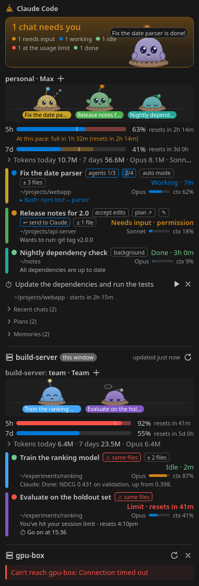
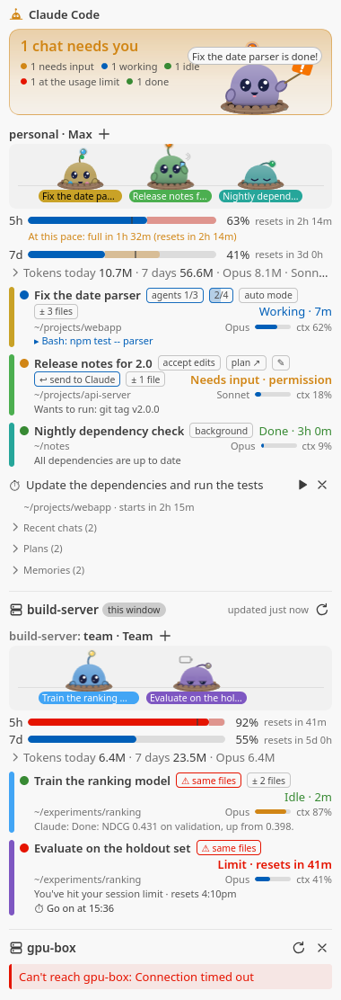
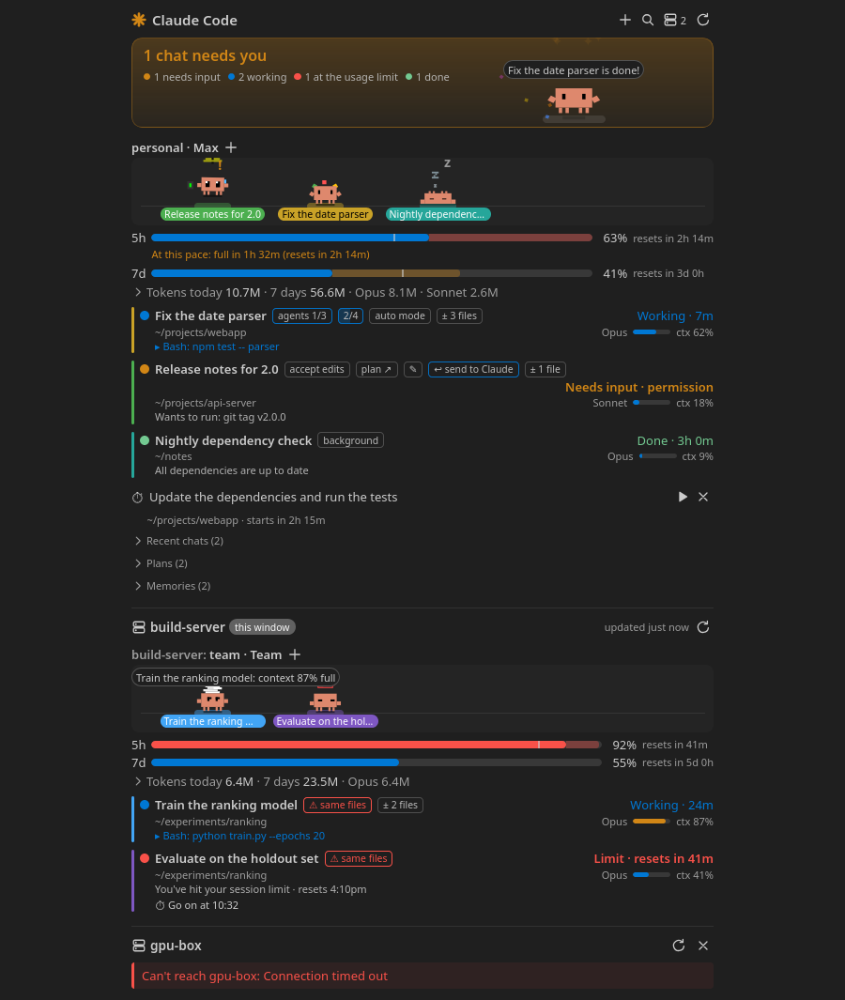

# Claude Status for VS Code

Every Claude Code chat you have running, on this computer and on your SSH
hosts, in one VS Code view: which ones need you, which are working, plan
usage, subagents, recent chats, and Clawd, the animated pet who acts it all
out. The VS Code companion of the
[Claude Status widget](https://github.com/wzaielamri/claude-status)
for KDE Plasma and GNOME; all of them use the same backend.

<!-- Screenshots show demo data only (Claude Status: Toggle Demo Data, or dev/harness.html), never real chats. -->
<p>
  
  
</p>

As an editor tab (**Claude Status: Open in Editor Tab**):



## What it shows

- **Every chat**, grouped by account: waiting for you (permission prompt,
  question…), working, your turn, finished. Background jobs too, and the
  subagents a chat runs.
- **Plan usage**: the 5-hour and weekly limits of each account with when they
  reset, today's and this week's tokens.
- **SSH hosts**: the chats on the hosts you pick, side by side with this
  computer's.
- **Notifications** (and a sound) when a chat needs you or finishes a long turn.
- **The status bar**: how many chats need you, the 5-hour usage.
- **Clawd**: one pet for the whole dashboard, one per chat, each acting out
  its chat. Click a pet to open its chat, drag one around, double-click the
  big one.

## Your side, also over Remote-SSH

The extension always runs on your computer (`"extensionKind": ["ui"]`), even
when the VS Code window is connected to a server with Remote-SSH. So one view
shows your local chats *and* the server's (and any other host's), whichever
machine the window is on:

```text
 your computer                                 an SSH host
┌───────────────────────────────────────┐
│ VS Code window (local or Remote-SSH)  │
│   Claude Status view (webview)        │
│   extension: runs here, always        │
│     ├─ reads ~/.claude* here          │       ┌────────────────────────┐
│     └─ ssh host 'python3 -' ──────────┼─────► │ reads its ~/.claude*   │
└───────────────────────────────────────┘       │ (nothing is installed) │
                                                └────────────────────────┘
```

The host your window is connected to is shown without setting anything up.
Other hosts: **Claude Status: Show Claude on SSH Hosts…** lists the ones in
`~/.ssh/config`. A host needs key-based login (the check never asks for a
password) and `python3` 3.7 or newer; nothing is installed there.

Clicking a chat opens it on the machine it's on: in VS Code's terminal here,
on the window's host, or through `ssh -t` for another host. A chat already
running in one of this window's terminals is brought to the front; a chat of
the Claude Code extension is revealed in it.

## Requirements

- VS Code 1.90 or newer.
- Python 3.7+ on this computer (`python3`, or set `claudeStatus.pythonPath`)
  and on every SSH host you pick.
- Linux on this computer for its running chats to show (they are found
  through `/proc`); SSH hosts work from macOS too.
- Claude Code. A plain `~/.claude` is all it needs; more profiles
  (`~/.claude-*`, `$CLAUDE_CONFIG_DIR`, `claudeStatus.extraConfigDirs`) are
  picked up as well.
- For plan usage bars: `jq`, and the status-line snippet (next section).

## Plan usage bars

Claude Code hands plan usage only to its status line. **Claude Status: Set Up
Plan Usage Bars…** adds a small snippet that keeps a copy of it:

- a status line that runs a script reading its input (`input=$(cat)`) gets
  the snippet after that line, the way the widget's `install.sh` adds it
  (the two never add it twice);
- a profile without a status line, or with another kind of command, gets a
  small wrapper as its status line, which keeps the copy and then shows what
  the status line showed before.

It shows what it will change (and the diff, if you like), asks, and backs up
every file it changes. **Remove the Plan Usage Status-Line Snippet** undoes
it. The bars fill in after the next reply in each account's chats.

## Install

Not on the Marketplace yet. Download `claude-status-<version>.vsix` from the
[latest release](https://github.com/wzaielamri/claude-status-vscode/releases/latest),
then in VS Code open the Extensions view, **⋯** → **Install from VSIX…**, or:

```sh
code --install-extension claude-status-<version>.vsix
```

A downloaded extension doesn't update by itself: install a newer release the
same way. Or build it from a clone:

```sh
npm ci
npm run package                     # builds claude-status-<version>.vsix
code --install-extension claude-status-*.vsix
```

## Settings

| Setting | Default | |
|---|---|---|
| `claudeStatus.sshHosts` | `[]` | SSH hosts to show (use the host picker) |
| `claudeStatus.includeCurrentRemote` | `true` | Also show the Remote-SSH window's host |
| `claudeStatus.remotePollSeconds` | `30` | How often hosts are checked |
| `claudeStatus.pollInterval` | `2000` | ms between checks of this computer while the view is open (10 s when hidden) |
| `claudeStatus.extraConfigDirs` | `[]` | More Claude Code config folders |
| `claudeStatus.openIn` | `vscode` | `system`: open chats in your desktop's terminal app instead |
| `claudeStatus.notifyWaiting` / `notifyDone` | `true` | Notifications; turn them off here if the Plasma or GNOME widget notifies too |
| `claudeStatus.notifyDoneMinSeconds` | `30` | Shortest turn that gets a "finished" notification |
| `claudeStatus.notifySound`, `soundVolume`, `soundWaiting`, `soundDone`, `soundFailed` | | Sounds (sound-theme names or files) |
| `claudeStatus.showPet` / `chatPets` | `true` / `5` | Clawd, and pets per account |
| `claudeStatus.showTokens`, `showUsageInStatusBar`, `recentChats`, `keepDoneHours` | | What the view shows |
| `claudeStatus.pythonPath` | `python3` | Python on this computer |

## Privacy

Nothing leaves your computer except the `ssh` connections to the hosts you
pick. There is no telemetry, and the view loads nothing from the internet.

What it reads, all of it written by Claude Code itself: the session registry
(`<config>/sessions`), background jobs (`<config>/jobs`), transcripts (for
token totals, chat titles and subagents), `history.jsonl` (recent folders),
the account name and plan from `.claude.json`, and the status-line copies in
`~/.cache/claude-widget/statusline`. It writes only to
`~/.cache/claude-widget` (caches, the list of chats you removed) and, if you
ask for it, the status-line change above.

## Good to know

- Every VS Code window runs its own copy; only the window you used last
  shows notifications and plays sounds.
- With the Plasma widget or the GNOME extension running too, both notify:
  turn notifications off in one of them.
- On KDE Plasma, a chat running in a terminal outside VS Code is brought to
  the front the way the widget does it (Konsole tab, window); on GNOME too,
  while the widget's Claude Status GNOME Shell extension is on. Elsewhere the
  view says where it runs. On GNOME, sounds use GNOME's sound theme.
- **Claude Status: Toggle Demo Data** shows made-up chats (for screenshots,
  or to try it without Claude Code).

## Development

```sh
npm ci
npm run build          # dist/: the extension and the webview
npm run check          # type-check both
npm test               # unit tests, and the backend on made-up homes
npm run watch          # rebuild on change; F5 in VS Code starts a test window
node esbuild.mjs --harness   # dev pages: look at the view with demo data in a browser
```

`vendor/` is the widget's backend and pet art, copied by
`scripts/sync-widget.sh` from a widget commit; change them there.

To release: raise `version` in `package.json`, add a `## <version>` section to
`CHANGELOG.md`, commit, then push a tag. The Release workflow checks, tests and
packages it and publishes the `.vsix` with those notes:

```sh
git tag v<version> && git push origin main v<version>
```

This repository is kept publishable: `scripts/check_public.py` refuses
commits with tokens, keys, IP addresses, emails, home folders or anything
naming the machine it runs on or its SSH hosts. Enable it once per clone:

```sh
git config core.hooksPath .githooks
```

## Credits

- Clawd pet art: [clawd-pet](https://github.com/abderrahimghazali/clawd-pet),
  MIT © Abderrahim Ghazali (`vendor/pets/LICENSE`).
- Backend: the [Claude Status widget](https://github.com/wzaielamri/claude-status) for KDE Plasma and GNOME.

Not affiliated with Anthropic. Claude and Claude Code are Anthropic's.

## License

MIT
